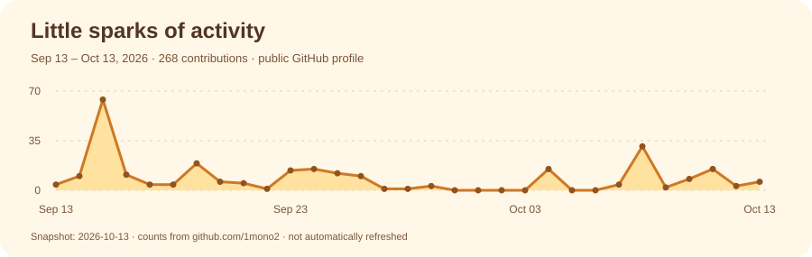

  

<h2 align="center">⚡ GitHub Activity</h2>

  

  

  

<h2 align="center">🍊 Tech Stack</h2>

  

---

Takahiro Morimoto · Founder, Mirai Yochi Co., Ltd.  
[morimoto@miraiyochi.ai](mailto:morimoto@miraiyochi.ai)
